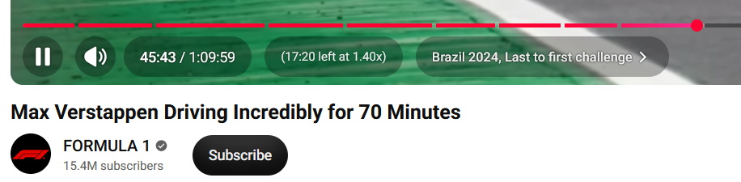
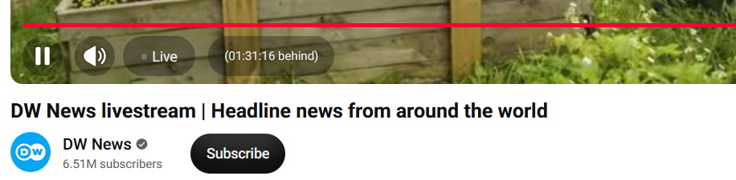
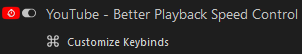
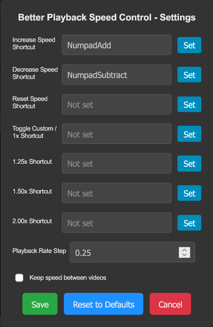

# YouTube - Better Playback Speed Control

BPSC is a userscript that allows a better control over the speed of a video with customizable keyboard shortcuts to increase, decrease and reset playback rate, while also displaying relevant information directly in the video player.

## Features

- **Speed Override:** Increases maximum playback speed to 5x (up from YouTube's default 2x).

- **Custom Settings:** Configurable keyboard shortcuts and step change (0.25 by default) via menu.

- **Direct Speed Shortcuts:** Optional keys that jump straight to 1.25x, 1.5x, or 2x.

- **Toggle Speed:** Optional key that switches between your custom speed and 1x, and back again.

- **Keep Speed Between Videos:** Optional setting to keep your current speed when moving to the next video, instead of resetting to 1x.

- **Time Remaining:** Shows the adjusted time to the end of the video at the current speed right in the video player.

- **Livestream Delay:** Displays how far behind you are in a livestream when rewinding.

## Installation

1. Install a userscript manager (like [Violentmonkey](https://violentmonkey.github.io/get-it/)).
2. [Click here to install](https://github.com/WesternFreak/YouTube-Better-Playback-Speed-Control/raw/main/yt-bpsc.user.js) the script.

## How to Use

### Default Keyboard Shortcuts

- Increase playback speed: `Numpad +`
- Decrease playback speed: `Numpad -`

The following shortcuts are optional and are not set by default:

- Reset playback speed to 1x
- Toggle between your custom speed and 1x
- Jump to 1.25x, 1.5x, or 2x

### Change Settings

1. Click the userscript manager icon in your browser.
2. Locate the "YouTube - Better Playback Speed Control" in the menu, then click "Settings":

3. Use the menu to set up your shortcuts, rate step, and whether speed is kept between videos:

